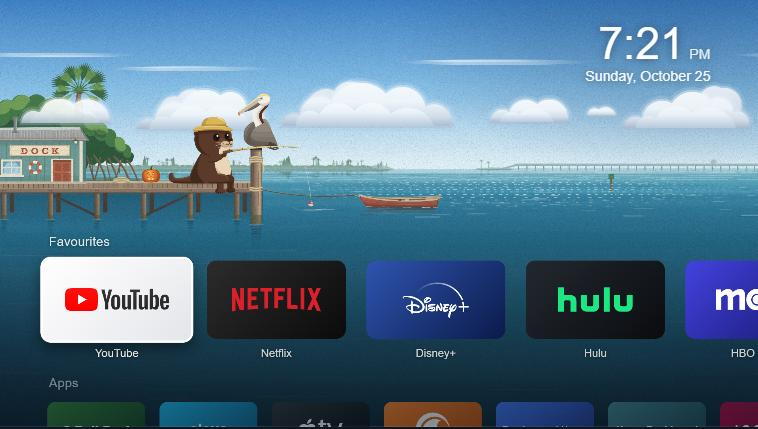
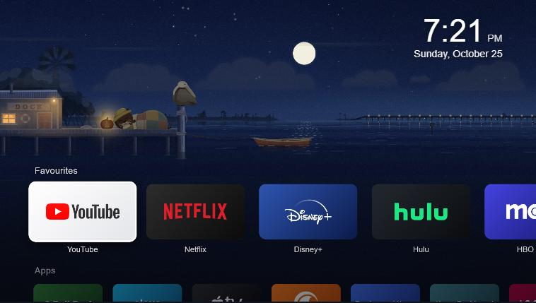
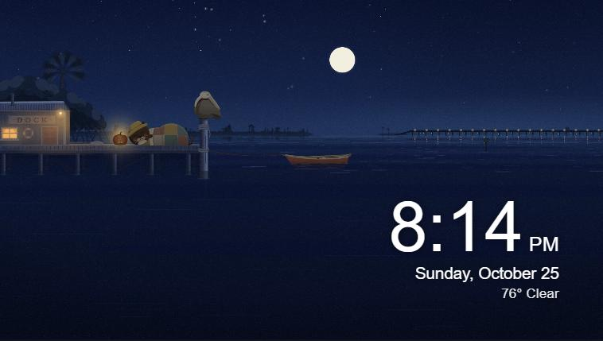

# webos-dock

A cosy, animated home screen app for **LG webOS TVs**. Your favourite streaming apps, every other app, HDMI inputs and
TV settings, laid out like a modern TV home screen, over a living lagoon scene that follows the real sun and moon.

No root needed: it installs through LG's official Developer Mode.



| Night | Idle clock |
|---|---|
|  |  |

## Features

- **Rows for everything**: Favourites (big 16:9 cards), Apps, and a TV row with HDMI inputs, Antenna/Live TV,
  AirPlay (Home Dashboard), TV Settings and LG's own home screen.
- **Remote-first**: arrows to move, OK to open, hold OK on an app to add, remove or reorder favourites. Magic Remote
  pointer works too.
- **Pip's Dock scene**: a hand-made animated backdrop. Pip the otter fishes by day and sleeps by his lantern at
  night, Gus the pelican guards the piling, and the odd manatee, dolphin, jumping fish, shooting star or rocket drops by.
  Five looks (dawn, day, golden hour, dusk, night) follow the real sun for your location, with the real moon phase.
- **Weather**: current temperature and conditions by the clock, from [Open-Meteo](https://open-meteo.com); clouds,
  rain ripples, storms and wind show up in the scene too.
- **Idle clock**: after 15 minutes without the remote, the rows fade and a big clock sits over the scene.
- **Quiet click sounds**, generated in code (no audio files).
- **Built for weak TV hardware**: only transform/opacity animations, a staged start, and an automatic frame-rate
  check that steps the animation down if a TV can't keep up.
- **Settings on the TV**: edit favourites, clock time zone, animation level, weather, idle clock, sounds, visitors.

## Requirements

- An LG TV with **webOS 6** or similar (developed on a 2021 4K model running webOS 6.5; other versions untested).
- A PC on the same network with **Node.js 18+**.
- A free [LG developer account](https://webostv.developer.lge.com) and the **Developer Mode** app from the
  LG Content Store.

## Quick start

1. **Get the code and the webOS CLI**

   ```bash
   git clone https://github.com/jaig-eye/webos-dock.git
   cd webos-dock
   npm install
   ```

2. **Turn on Developer Mode on the TV.** Install the *Developer Mode* app from the LG Content Store, sign in with your
   LG developer account, switch **Dev Mode Status** on (the TV restarts), then reopen the app and switch
   **Key Server** on.

3. **Connect the PC to the TV** (Windows; replace the IP with your TV's):

   ```bash
   tools\ares ares-setup-device --add tv -i host=192.168.x.x -i port=9922 -i username=prisoner
   tools\ares ares-novacom --device tv --getkey
   ```

   Type the passphrase shown in the Developer Mode app. On macOS/Linux use `npx ares-setup-device ...` and
   `npx ares-novacom ...` instead of `tools\ares`.

4. **Set your location** in `home/js/config.js` (`weather.lat` / `weather.lon`, rounded to about 0.1°). It drives the
   weather and the scene's sunrise and sunset. Optionally set `timeZone` if your TV's clock zone is wrong.

5. **Build, install and open**

   ```bash
   tools\ares ares-package home -o dist --no-minify
   tools\ares ares-install --device tv dist\com.jaigeye.home_1.0.4_all.ipk
   tools\ares ares-launch --device tv com.jaigeye.home
   ```

   Dock now appears in the TV's app list.

## Good to know

- **It's an app, not a replacement home screen.** webOS doesn't let a normal app take over the Home button or start
  at power-on; that needs a rooted TV. Open Dock from the app list, or bind it to a number key (open Dock, then hold a
  number 1-8 on the remote) where your remote supports Quick Access.
- **Developer Mode expires** after about 1000 hours. Press **EXTEND** in the Developer Mode app now and then, or run
  `tools\renew-devmode.cmd`. If it lapses, Dock is removed and the TV simply behaves like stock; reinstall to bring
  it back.
- **App list**: webOS 6 doesn't let apps list what's installed, so Dock ships a catalogue of common US app IDs
  (`home/js/catalog.js`) and shows only those that are installed. Add your own entries there; website shortcuts that
  open in LG's browser are supported too.

## Optional: brand logos on the cards

The repository ships **text cards** only. To show logos on your own TV:

```bash
node tools/fetch-logos.js
node tools/build-logos.js
```

This downloads pinned marks from [Simple Icons](https://simpleicons.org) (CC0) and
[ln-dev7/logos-apps](https://github.com/ln-dev7/logos-apps). Logos are trademarks of their owners; please don't
redistribute builds that include them. You can also drop any image into `home/assets/logos/custom/<appId>.png`.

## Project structure

```
home/                 the TV app (plain HTML/CSS/JS, no build step, ES2017 for Chromium 79)
  js/                 config, catalogue, rows and focus, settings, weather, idle clock, sounds
  scene/              Pip's Dock: scene engine, SVG art, pre-rendered backgrounds
scene-src/            source for the scene: art style guide, SVG art, background generator (plate.js),
                      preview page and renderers
tools/                CLI wrapper (ares.cmd), logo fetch/build, preview server, Dev Mode renewal, dev logger
```

**Previewing on a PC**: `node tools/static-server.js home 5179` and open http://127.0.0.1:5179 (TV calls are mocked).

**Editing the scene art**: serve `scene-src` with `node scene-src/tools/dev-server.js`, open `/render.html` to
re-render the five backgrounds into `scene-src/plates/`, then copy them to `home/scene/plates/`. `/index.html?fit=1`
previews the scene; keys 1-5 switch the time of day, M/D/F/B/S/R trigger the visitors.

**Development logging**: set `debugLogger` in `home/js/config.js` to `http://<your PC IP>:8765/log` and run
`node tools/dev-logger.js <your PC IP>` to see errors, timings and frame-rate checks from the TV.

## Credits

- Weather data by [Open-Meteo.com](https://open-meteo.com) (CC BY 4.0), free for non-commercial use.
- Built with LG's [webOS TV CLI](https://www.npmjs.com/package/@webos-tools/cli).
- Not affiliated with or endorsed by LG Electronics or any streaming service.

## License

[MIT](LICENSE)
