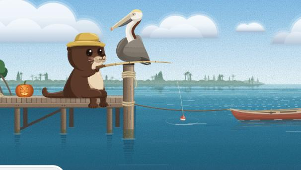
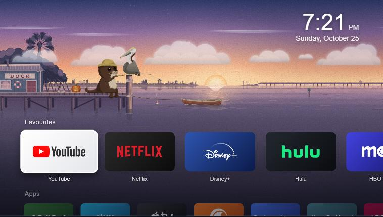

<div align="center">


# Dock

**A cosy, animated home screen for LG webOS TVs.**<br>
Your favourite streaming apps, HDMI inputs and TV settings, over a lagoon that follows the real sun and moon.

[](package.json)
[](https://webostv.developer.lge.com)
[](#-quick-start)
[](LICENSE)

[Quick start](#-quick-start) · [Features](#-features) · [Screenshots](#-screenshots) · [Customise](#-customise) · [Good to know](#-good-to-know)

<br>


</div>

> [!NOTE]
> Dock is an **app**, not a replacement for LG's own Home button. webOS only lets a rooted TV do that, and this project deliberately needs no root. You open it from the app list. See [Good to know](#-good-to-know).

## ✨ Features

- 📺 **Rows for everything.** Favourites (big 16:9 cards), Apps, and a TV row with your HDMI inputs, Antenna/Live TV, AirPlay (opens LG's Home Dashboard), TV Settings, LG's own home screen and Dock's settings.
- 🎮 **Built for the remote.** Arrows to move, OK to open, hold OK on an app to add it to or remove it from Favourites or move it along the row. The Magic Remote pointer works too.
- 🦦 **Pip's Dock.** A hand-made animated backdrop: Pip the otter fishes by day and sleeps by his lantern at night, Gus the pelican guards the piling, and the odd manatee, dolphin, jumping fish, shooting star or rocket drops by. Five looks (dawn, day, golden hour, dusk, night) follow the real sun for your location, with the real moon phase.
- 🌤️ **Weather.** Temperature and conditions beside the clock from [Open-Meteo](https://open-meteo.com), and the scene shows it: clouds, rain ripples, storms and wind.
- 🕰️ **Idle clock.** After 15 minutes without the remote, the rows fade and a big clock, the date and the weather sit over the scene.
- 🔈 **Quiet click sounds**, generated in code (no audio files).
- 🪶 **Built for weak TV hardware.** Only transform and opacity animations, a staged start, an automatic frame-rate check that steps the animation down if a TV can't keep up, and the scene is unloaded while another app is on screen so that app gets the memory.
- ⚙️ **Settings on the TV.** Edit favourites, clock time zone, animation level, weather, idle clock, sounds and the little visitors, all from the remote.

## 📸 Screenshots

<table>
  <tr>
    <td width="50%"><br><sub>🌙 <b>Night.</b> The moon is the real phase; Pip is asleep by his lantern.</sub></td>
    <td width="50%"><br><sub>🕰️ <b>Idle clock.</b> The rows fade away and a big clock takes over.</sub></td>
  </tr>
  <tr>
    <td><br><sub>🦦 <b>Pip and Gus.</b> The characters are hand-drawn SVGs.</sub></td>
    <td><br><sub>🌅 <b>Dawn.</b> The look changes through the day with the sun.</sub></td>
  </tr>
</table>

## 🚀 Quick start

### What you need

| | |
| --- | --- |
| **An LG TV** | webOS 6 or similar. Developed on a 2021 4K model running webOS 6.5; other versions are untested. |
| **A PC on the same network** | With [Node.js](https://nodejs.org) 18 or newer. Windows, macOS or Linux. |
| **An LG developer account** | Free, at [webostv.developer.lge.com](https://webostv.developer.lge.com). |
| **The Developer Mode app** | Free, from the LG Content Store on the TV. |

### Install

**1. Get the code and the webOS CLI**

```bash
git clone https://github.com/jaig-eye/webos-dock.git
cd webos-dock
npm install
```

**2. Turn on Developer Mode on the TV.** Install the *Developer Mode* app from the LG Content Store and sign in with your LG developer account. Switch **Dev Mode Status** on (the TV restarts), then reopen the app and switch **Key Server** on. LG's own guide is [here](https://webostv.developer.lge.com/develop/getting-started/developer-mode-app).

**3. Connect your PC to the TV.** Replace the IP address with your TV's (it's in the TV's network settings):

```bash
npx ares-setup-device --add tv -i host=192.168.x.x -i port=9922 -i username=prisoner
npx ares-novacom --device tv --getkey
```

Type the passphrase shown in the Developer Mode app when asked. Keep the device name `tv`; the npm scripts below use it.

> [!TIP]
> On Windows, `tools\ares` runs the same commands (for example `tools\ares ares-novacom --device tv --getkey`) and keeps the TV's details inside the project's `.ares` folder. Use it if a command says *No matched device*.

**4. Set your location** in [`home/js/config.js`](home/js/config.js): `weather.lat` and `weather.lon`, rounded to about 0.1°. It drives the weather and the scene's sunrise and sunset. The default is New York City.

**5. Build, install and open**

```bash
npm run package
npm run install:tv
npm run launch:tv
```

Dock now appears in the TV's app list. The packager warns that `requiredACG` isn't declared; that setting doesn't exist on this webOS version, so the warning can be ignored.

To remove it: `npx ares-install --device tv --remove com.jaigeye.home`.

## 🎮 Using it

| On the remote | What it does |
| --- | --- |
| **Arrows** | Move between cards and rows. |
| **OK** | Open the app, input or setting. |
| **Hold OK on an app** | A menu: add to or remove from Favourites, move left or right, open. |
| **Back** | Close a menu or settings screen. |
| **Any key on the idle clock** | Brings the rows back. That key does nothing else. |

**Dock Settings** is the last tile in the TV row.

## 🔧 Customise

Everything lives in plain HTML, CSS and JavaScript under [`home/`](home); there is no build step beyond packaging.

| What | Where | Default |
| --- | --- | --- |
| Location for weather and the sun | `weather` in [`home/js/config.js`](home/js/config.js) | New York City (an example) |
| Clock time zone | `timeZone` in `config.js`, or Dock Settings | The TV's own setting |
| Idle clock | `idleMinutes` in `config.js`, or Dock Settings | 15 minutes (0 = off) |
| Click sounds | `sounds` in `config.js`, or Dock Settings | On, quiet |
| Name phones show when casting | `tvName` in `config.js` | "your TV" |
| Favourites | Dock Settings → Edit favourites; the starting list is `defaultFavs` in [`catalog.js`](home/js/catalog.js) | YouTube, Netflix, Disney+, Hulu, HBO Max, Peacock, Prime Video |

**Add an app or a website.** Entries are one line each in [`home/js/catalog.js`](home/js/catalog.js). A website shortcut opens in LG's web browser; give it any unique id that starts with `web.`:

```js
{ id: 'web.example', name: 'My Site', wm: 'My Site', web: 'https://example.com/',
  bg: 'linear-gradient(135deg,#3a1622,#0d0a10)', fg: '#fff', fw: 700, ls: '0', fs: 48 },
```

### Brand logos (optional)

The repository ships **text cards** only. To show logos on your own TV:

```bash
npm run fetch-logos
npm run build-logos
```

This downloads pinned marks from [Simple Icons](https://simpleicons.org) (CC0) and [ln-dev7/logos-apps](https://github.com/ln-dev7/logos-apps), and builds the cards from them. Logos are trademarks of their owners, so please don't redistribute builds that include them. You can also drop any image into `home/assets/logos/custom/<appId>.png`.

## 💡 Good to know

- **It's an app, not a replacement home screen.** webOS has no setting that lets a normal app take over the Home button or start at power-on; that takes a rooted TV, and the known ways to root recent TVs have been patched. Open Dock from the app list, or bind it to a number key (open Dock, then hold a number 1-8) on remotes that support Quick Access. LG's own home screen is one tile away, in the TV row.
- **Developer Mode expires** after about 1000 hours. Press **Extend** in the Developer Mode app now and then; `tools\renew-devmode.cmd` tries to do it from your PC. If it lapses, Dock is removed and the TV behaves like stock; reinstall to bring it back.
- **The app list is a catalogue.** webOS 6 doesn't let apps list what's installed, so Dock ships a catalogue of common US app IDs and shows only those that are installed. Add your own entries to `catalog.js`.
- **Memory is tight on these TVs.** That's why Dock unloads the scene while another app is open. If animation ever stutters, **Dock Settings → Backdrop animation** steps it down, and **Run speed test** measures the frame rate.
- **Safe to try.** Dock launches apps and reads a little system information (which apps are installed, HDMI status, the TV model and clock format). It doesn't change any TV settings, and removing it puts the TV back to stock.

## 🧱 Project structure

```
home/                 the TV app (plain HTML/CSS/JS, ES2017 for the TV's Chromium 79)
  js/                 config, catalogue, rows and focus, settings, weather, idle clock, sounds
  scene/              Pip's Dock: scene engine, SVG art, pre-rendered backgrounds
scene-src/            scene source: art style guide, SVG art, background generator (plate.js), preview and renderers
tools/                CLI wrapper (ares.cmd), logo fetch/build, preview server, Dev Mode renewal, dev logger
docs/                 logo and screenshots for this README
```

## 💻 Development

**Preview on a PC.** The TV calls are mocked in a desktop browser:

```bash
npm run preview
```

Then open http://127.0.0.1:5179.

**Edit the scene art.** Serve the source with `node scene-src/tools/dev-server.js`, open `/render.html` to re-render the five backgrounds into `scene-src/plates/`, then copy them to `home/scene/plates/`. `/index.html?fit=1` previews the scene; keys 1-5 switch the time of day, and M, D, F, B, S and R trigger the visitors.

**See errors and timings from the TV.** Set `debugLogger` in `home/js/config.js` to `http://<your PC's IP>:8765/log`, run `node tools/dev-logger.js <your PC's IP>`, then rebuild and install. Set it back to `null` for normal use.

## 🙏 Credits

- Weather data by [Open-Meteo.com](https://open-meteo.com) (CC BY 4.0), free for non-commercial use.
- Built with LG's [webOS TV CLI](https://www.npmjs.com/package/@webos-tools/cli).
- Optional logos from [Simple Icons](https://simpleicons.org) and [ln-dev7/logos-apps](https://github.com/ln-dev7/logos-apps).
- Pip, Gus and the scene art are original to this project and covered by the same licence.
- Not affiliated with or endorsed by LG Electronics or any streaming service. All trademarks belong to their owners.

## 📄 License

[MIT](LICENSE)
